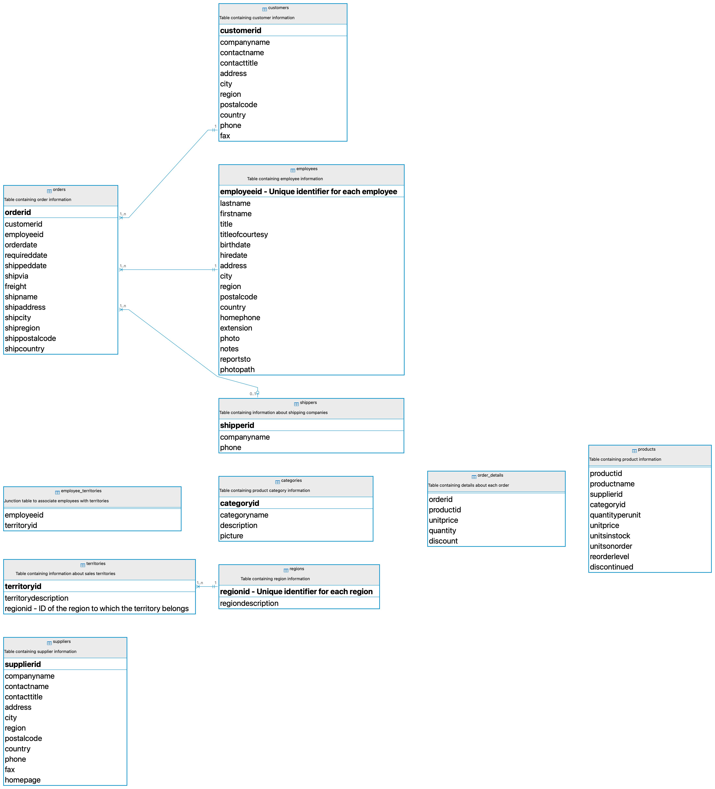

# Analyze the Northwind Dataset
In this exercise, you will analyze the `Northwind` dataset using SQL queries. The `Northwind` dataset is a sample database used by Microsoft for tutorials and examples. It contains tables for products, orders, customers, employees, and more. 

<p align="center">
<div style="display: inline-block; background-color: violet; padding: 10px; border-radius: 5px;\">
   
</div>
    <br>
    <em style="display: block; text-align: center;">Northwind Data</em> 
</p>

## Instructions
1. Connect to the `northwind` schema in the database using DBeaver.
2. Write SQL queries to answer the following questions:
    - Get the names and the quantities in stock for each product.
    - Get a list of customers who are located in 'Germany'.
    - Calculate the average days to ship
    - Get a list of current products (Product ID and name).
    - Get a list of the most and least expensive products (name and unit price).
    - Get products that cost less than $20.
    - Get products that cost between $15 and $25
    - Find the products with prices above the average price.
    - Find the ten most expensive products
    - Get a list of discontinued products (Product ID and name).
    - Count current and discontinued products.
    - Find products with less units in stock than the quantity on order.
    - Find the customer who had the highest order amount.
    - Get orders for a given employee and the according customer.
    - Find the hiring age of each employee
    - Get number of customers in each city
    - Find the total number of orders placed by each customer.
    - Get the average price of products for each category.
    - Get a list of employees and their assigned territories.
    - Get the orders that contain products in the 'Beverages' category.
    - Get the total number of orders placed in the year 1997.
    - Find products ordered the most.
    - Find customers who ordered products in more than one category.
    - Generate a summary report for each product category showing the total quantity sold, total sales, and number of orders.
    - Rank employees based on their total sales.
    - Calculate running total sales per order.
    - Find the difference in sales between each order and the previous order
    - Find the total sales per product and then get the top 5 selling products

3. Save your queries in a `.sql` file.

## Resources
[EXTRACT() : Function to extract time related fields](https://www.postgresql.org/docs/current/functions-datetime.html)

## Lösungen

> Alle Abfragen nutzen den Präfix `northwind.` und laufen unabhängig vom eingestellten Schema. Getestet gegen die Kurs-Datenbank am 08.10.2026 und abgeglichen mit den Bildern in [`5_northwind_exercises_query_outputs.md`](5_northwind_exercises_query_outputs.md).
>
> **Umsatz:** Die Musterlösung rechnet nicht einheitlich. Aufgaben 13, 24, 25 und 27 nutzen den Bestellpreis (`order_details.unitprice`), Aufgaben 26 und 28 den Listenpreis (`products.unitprice`), keine zieht den Rabatt ab. Die Lösungen folgen jeweils dem Musterbild. Betriebswirtschaftlich korrekt wäre `od.unitprice * od.quantity * (1 - od.discount)`.

### 01. Get the names and the quantities in stock for each product.

```sql
SELECT productname, unitsinstock FROM northwind.products;
```
Ergebnis: 77 Zeilen, erste Zeile: Chai, 39

### 02. Get a list of customers who are located in 'Germany'.

```sql
SELECT * FROM northwind.customers WHERE country = 'Germany';
```
Ergebnis: 11 Zeilen, erste Zeile: ALFKI, Alfreds Futterkiste, Maria Anders, Sales Representative, Obere Str. 57, Berlin, None, 12209, Germany, 030-0074321, 030-0076545

### 03. Calculate the average days to ship

```sql
SELECT AVG(shippeddate - orderdate) AS avg_days_to_ship FROM northwind.orders;
```
Ergebnis: avg_days_to_ship = 8.4919653893695921

### 04. Get a list of current products (Product ID and name).

```sql
SELECT productid, productname FROM northwind.products WHERE discontinued = false;
```
Ergebnis: 69 Zeilen, erste Zeile: 1, Chai

### 05. Get a list of the most and least expensive products (name and unit price).

```sql
SELECT productname, unitprice FROM northwind.products
WHERE unitprice = (SELECT MAX(unitprice) FROM northwind.products)
   OR unitprice = (SELECT MIN(unitprice) FROM northwind.products);
```
Ergebnis: 2 Zeilen, erste Zeile: Geitost, 2,50

### 06. Get products that cost less than $20.

```sql
SELECT productname, unitprice FROM northwind.products WHERE unitprice < 20;
```
Ergebnis: 39 Zeilen, erste Zeile: Chai, 18,00

### 07. Get products that cost between $15 and $25

```sql
SELECT productname, unitprice FROM northwind.products WHERE unitprice BETWEEN 15 AND 25;
```
Ergebnis: 25 Zeilen, erste Zeile: Chai, 18,00

### 08. Find the products with prices above the average price.

```sql
SELECT productname, unitprice FROM northwind.products
WHERE unitprice > (SELECT AVG(unitprice) FROM northwind.products);
```
Ergebnis: 25 Zeilen, erste Zeile: Uncle Bob's Organic Dried Pears, 30,00

### 09. Find the ten most expensive products

```sql
SELECT productname, unitprice FROM northwind.products ORDER BY unitprice DESC LIMIT 10;
```
Ergebnis: 10 Zeilen, erste Zeile: Côte de Blaye, 263,50

### 10. Get a list of discontinued products (Product ID and name).

```sql
SELECT productid, productname FROM northwind.products WHERE discontinued = true;
```
Ergebnis: 8 Zeilen, erste Zeile: 5, Chef Anton's Gumbo Mix

### 11. Count current and discontinued products.

```sql
SELECT COUNT(*) FILTER (WHERE discontinued = false) AS current_products,
       COUNT(*) FILTER (WHERE discontinued = true) AS discontinued_products
FROM northwind.products;
```
Ergebnis: current_products = 69, discontinued_products = 8

### 12. Find products with less units in stock than the quantity on order.

```sql
SELECT productname, unitsinstock, unitsonorder FROM northwind.products WHERE unitsinstock < unitsonorder;
```
Ergebnis: 14 Zeilen, erste Zeile: Chang, 17, 40

### 13. Find the customer who had the highest order amount.

```sql
SELECT c.contactname, SUM(od.unitprice * od.quantity) AS total_amount_order
FROM northwind.orders o
JOIN northwind.order_details od ON o.orderid = od.orderid
JOIN northwind.customers c ON o.customerid = c.customerid
GROUP BY c.customerid, c.contactname
ORDER BY total_amount_order DESC LIMIT 1;
```
Ergebnis: contactname = Horst Kloss, total_amount_order = 117.483,39

Hinweis: Gemeint ist der Gesamtumsatz je Kunde über alle Bestellungen.

### 14. Get orders for a given employee and the according customer.

```sql
SELECT o.orderid, o.orderdate, e.employeeid, e.firstname, e.lastname, c.customerid, c.companyname
FROM northwind.orders o
JOIN northwind.employees e ON o.employeeid = e.employeeid
JOIN northwind.customers c ON o.customerid = c.customerid
WHERE o.employeeid = 1
ORDER BY o.orderid;
```
Ergebnis: 123 Zeilen, erste Zeile: 10258, 1996-07-17, 1, Nancy, Davolio, ERNSH, Ernst Handel

### 15. Find the hiring age of each employee

```sql
SELECT employeeid, firstname, lastname, birthdate, hiredate,
       EXTRACT(YEAR FROM hiredate) - EXTRACT(YEAR FROM birthdate) AS hiring_age
FROM northwind.employees ORDER BY employeeid;
```
Ergebnis: 9 Zeilen, erste Zeile: 1, Nancy, Davolio, 1948-12-08, 1992-05-01, 44

Hinweis: Wie im Musterbild: Jahr der Einstellung minus Geburtsjahr. Das exakte Alter kann ein Jahr darunter liegen (Nancy Davolio war genau genommen 43).

### 16. Get number of customers in each city

```sql
SELECT city, COUNT(*) AS number_of_customers FROM northwind.customers GROUP BY city ORDER BY number_of_customers DESC;
```
Ergebnis: 70 Zeilen, erste Zeile: London, 6

### 17. Find the total number of orders placed by each customer.

```sql
SELECT customerid, COUNT(*) AS total_orders FROM northwind.orders GROUP BY customerid ORDER BY total_orders DESC;
```
Ergebnis: 89 Zeilen, erste Zeile: SAVEA, 31

### 18. Get the average price of products for each category.

```sql
SELECT c.categoryname, AVG(p.unitprice) AS avg_price FROM northwind.products p
JOIN northwind.categories c ON p.categoryid = c.categoryid GROUP BY c.categoryname;
```
Ergebnis: 8 Zeilen, erste Zeile: Grains/Cereals, 20,25

### 19. Get a list of employees and their assigned territories.

```sql
SELECT e.firstname, e.lastname, t.territorydescription FROM northwind.employees e
JOIN northwind.employee_territories et ON e.employeeid = et.employeeid
JOIN northwind.territories t ON et.territoryid = t.territoryid;
```
Ergebnis: 49 Zeilen, erste Zeile: Nancy, Davolio, Wilton

### 20. Get the orders that contain products in the 'Beverages' category.

```sql
SELECT o.orderid, o.orderdate, cu.companyname, p.productname
FROM northwind.orders o
JOIN northwind.customers cu ON o.customerid = cu.customerid
JOIN northwind.order_details od ON o.orderid = od.orderid
JOIN northwind.products p ON od.productid = p.productid
JOIN northwind.categories c ON p.categoryid = c.categoryid
WHERE c.categoryname = 'Beverages'
ORDER BY o.orderid;
```
Ergebnis: 404 Zeilen, erste Zeile: 10253, 1996-07-10, Hanari Carnes, Chartreuse verte

### 21. Get the total number of orders placed in the year 1997.

```sql
SELECT COUNT(*) AS orders_1997 FROM northwind.orders WHERE EXTRACT(YEAR FROM orderdate) = 1997;
```
Ergebnis: orders_1997 = 408

### 22. Find products ordered the most.

```sql
SELECT p.productname, SUM(od.quantity) AS total_quantity_ordered
FROM northwind.order_details od
JOIN northwind.products p ON od.productid = p.productid
GROUP BY p.productname ORDER BY total_quantity_ordered DESC;
```
Ergebnis: 77 Zeilen, erste Zeile: Camembert Pierrot, 1577

### 23. Find customers who ordered products in more than one category.

```sql
SELECT cu.customerid, cu.companyname, COUNT(DISTINCT p.categoryid) AS num_categories_ordered
FROM northwind.customers cu
JOIN northwind.orders o ON cu.customerid = o.customerid
JOIN northwind.order_details od ON o.orderid = od.orderid
JOIN northwind.products p ON od.productid = p.productid
GROUP BY cu.customerid, cu.companyname
HAVING COUNT(DISTINCT p.categoryid) > 1
ORDER BY cu.customerid;
```
Ergebnis: 89 Zeilen, erste Zeile: ALFKI, Alfreds Futterkiste, 5

### 24. Generate a summary report for each product category showing the total quantity sold, total sales, and number of orders.

```sql
SELECT c.categoryname, SUM(od.quantity) AS total_quantity_sold,
       SUM(od.unitprice * od.quantity) AS total_sales,
       COUNT(DISTINCT od.orderid) AS num_orders
FROM northwind.order_details od
JOIN northwind.products p ON od.productid = p.productid
JOIN northwind.categories c ON p.categoryid = c.categoryid
GROUP BY c.categoryname ORDER BY c.categoryname;
```
Ergebnis: 8 Zeilen, erste Zeile: Beverages, 9532, 286.526,95, 354

Hinweis: Umsatz wie im Musterbild: Bestellpreis mal Menge, ohne Rabatt.

### 25. Rank employees based on their total sales.

```sql
SELECT e.employeeid, e.firstname, e.lastname,
       SUM(od.unitprice * od.quantity) AS total_sales,
       RANK() OVER (ORDER BY SUM(od.unitprice * od.quantity) DESC) AS sales_rank
FROM northwind.employees e
JOIN northwind.orders o ON e.employeeid = o.employeeid
JOIN northwind.order_details od ON o.orderid = od.orderid
GROUP BY e.employeeid, e.firstname, e.lastname
ORDER BY sales_rank;
```
Ergebnis: 9 Zeilen, erste Zeile: 4, Margaret, Peacock, 250.187,45, 1

Hinweis: Umsatz wie im Musterbild: Bestellpreis mal Menge, ohne Rabatt.

### 26. Calculate running total sales per order.

```sql
WITH order_sales AS (
    SELECT o.orderid, o.orderdate, SUM(p.unitprice * od.quantity) AS order_sales
    FROM northwind.orders o
    JOIN northwind.order_details od ON o.orderid = od.orderid
    JOIN northwind.products p ON od.productid = p.productid
    GROUP BY o.orderid, o.orderdate)
SELECT orderid, orderdate, order_sales,
       SUM(order_sales) OVER (ORDER BY orderid) AS running_total_sales
FROM order_sales ORDER BY orderid;
```
Ergebnis: 830 Zeilen, erste Zeile: 10248, 1996-07-04, 566,00, 566,00

Hinweis: Umsatz wie im Musterbild: **Listenpreis** aus `products` mal Menge (nicht der Bestellpreis).

### 27. Find the difference in sales between each order and the previous order

```sql
WITH order_sales AS (
    SELECT o.orderid, o.orderdate, SUM(od.unitprice * od.quantity) AS order_sales
    FROM northwind.orders o
    JOIN northwind.order_details od ON o.orderid = od.orderid
    GROUP BY o.orderid, o.orderdate)
SELECT orderid, orderdate, order_sales,
       LAG(order_sales) OVER (ORDER BY orderdate) AS previous_order_sales,
       order_sales - LAG(order_sales) OVER (ORDER BY orderdate) AS sales_diff
FROM order_sales ORDER BY orderdate;
```
Ergebnis: 830 Zeilen, erste Zeile: 10248, 1996-07-04, 440,00, None, None

Hinweis: Umsatz wie im Musterbild: Bestellpreis mal Menge, ohne Rabatt. Sortiert nach Bestelldatum.

### 28. Find the total sales per product and then get the top 5 selling products

```sql
SELECT p.productid, p.productname, SUM(p.unitprice * od.quantity) AS total_sales
FROM northwind.order_details od
JOIN northwind.products p ON od.productid = p.productid
GROUP BY p.productid, p.productname
ORDER BY total_sales DESC LIMIT 5;
```
Ergebnis: 5 Zeilen, erste Zeile: 38, Côte de Blaye, 164.160,50

Hinweis: Umsatz wie im Musterbild: **Listenpreis** aus `products` mal Menge.
